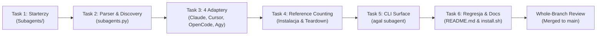

# Agal — Raport Wdrożenia Architektury Subagentów

> **Data wdrożenia:** 2026-10-21  
> **Status:** Ukończono i scalono do gałęzi `main`  
> **Zatwierdzenie:** Whole-Branch Review Approved (Model: Gemini Pro)  
> **Testy:** 107 / 107 zaliczonych (`pytest`)

---

## 1. Cel i Geneza Zmiany

Dotychczasowy model działania `agal` opierał się na presetach (wiązkach skilli i serwerów MCP podłączanych do głównej sesji agenta). Nowa koncepcja rozszerza aplikację o **wyspecjalizowanych subagentów**:
- Zamiast obciążać głównego agenta wszystkimi narzędziami naraz, `agal` przygotowuje wąsko wyspecjalizowanych pomocników (np. do researchu, audytu, UI).
- Główny agent w CLI lub IDE posiada pełną wiedzę o tych pomocnikach i deleguje do nich zadania w miarę potrzeb.
- **Wspierane platformy:** Claude Code, Cursor IDE, OpenCode, Antigravity (Agy).
- **Zasada nienaruszalności:** Presety nie zostały usunięte – stanowią równorzędną, nadal w pełni wspieraną oś narzędziową.
- **Złota zasada izolacji:** Wszystkie generowane pliki, powiązania i konfiguracje zachodzą *wyłącznie lokalnie w katalogu projektu* (zero modyfikacji profilu użytkownika).

---

## 2. Zrealizowany Plan Wdrożenia (100% Ukończony)

Wdrożenie zostało zrealizowane w metodologii **Subagent-Driven Development (SDD)** w ścisłym reżimie **TDD** z niezależnymi przeglądami jakości po każdym zadaniu.

### Szczegółowa realizacja zadań:

- [x] **Task 1: Bundled Starter Subagents**
  - Utworzono definicje [Subagents/researcher/AGENT.md](Subagents/researcher/AGENT.md), [auditor](Subagents/auditor/AGENT.md) oraz [ui-specialist](Subagents/ui-specialist/AGENT.md).
  - Skonfigurowano metadane YAML (`name`, `description` z klauzulą `Use when …`, `permissions`, `skills`, `mcp`, `model`).
  - *Recenzja Task 1:* Spec ✅, Quality: Approved.

- [x] **Task 2: Parser, Discovery & Template Generator**
  - Zaimplementowano moduł [agal/subagents.py](agal/subagents.py) (`load_subagent`, `list_subagents`, `save_subagent_template`).
  - Rozszerzono [agal/config.py](agal/config.py) o `get_subagents_dir` oraz `install.sh` o dowiązanie do `~/.agal/subagents`.
  - Ścisła walidacja błędów frontmattera (zwracanie czytelnych `ValueError` ze ścieżką pliku).
  - *Recenzja Task 2:* Spec ✅, Quality: Approved.

- [x] **Task 3: Native Multi-Platform Runtime Adapters**
  - Zaimplementowano generator natywnych formatów `render_adapters` dla:
    - **Claude Code:** `.claude/agents/<name>.md` z regułami `disallowedTools`.
    - **Cursor:** `.cursor/agents/<name>.md` z flagą `readonly: true`.
    - **OpenCode:** `.opencode/agents/<name>.md` z mapowaniem `permission: {edit, bash}`.
    - **Antigravity (Agy):** `.agents/agents/<name>/agent.md` z listą narzędzi i prefiksem `skills/`.
  - Zaimplementowano bezpieczne materializowanie z ochroną istniejących plików użytkownika (clobber protection) oraz usuwanie z rekursywnym prunowaniem pustych folderów.
  - *Recenzja Task 3:* Spec ✅, Quality: Approved.

- [x] **Task 4: Reference Counting & Dependency Lifecycle**
  - Zaimplementowano `install_subagent`, `remove_subagent` oraz `unprepare_all_subagents`.
  - Wprowadzono śledzenie referencji w `.agal_state.json` (`subagent_owned`): usunięcie agenta nie usuwa skilli współdzielonych z aktywnym presetem lub innym subagentem.
  - Zaktualizowano [agal/skills.py](agal/skills.py) i [agal/mcp.py](agal/mcp.py) (usuwanie pustego `.mcp.json`).
  - *Recenzja Task 4:* Spec ✅, Quality: Approved.

- [x] **Task 5: CLI Surface (`argparse`)**
  - Zaimplementowano grupę poleceń w [agal/cli.py](agal/cli.py):
    - `agal subagent add [NAMES...]` (interaktywne menu `fzf` przy braku argumentów)
    - `agal subagent remove NAMES...`
    - `agal subagent list`
    - `agal subagent create NAME`
  - Wpięto usuwanie subagentów przed odinstalowaniem presetów w `agal unprepare` oraz `agal remove preset`.
  - Zabezpieczono komendę przed shadowingiem przez presety (`known_commands`).
  - *Recenzja Task 5:* Spec ✅, Quality: Approved.

- [x] **Task 6: Regression, Documentation & Bugfix**
  - Uzupełniono [README.md](README.md) o sekcję `## Subagents`, format `AGENT.md` oraz tabelę uprawnień.
  - Naprawiono błąd zmiennej nieprzypisanej `SKILLS_DIR` w [install.sh](install.sh) przy ponownym uruchomieniu instalatora.
  - Pełny zestaw testów przeszedł bez regresji.
  - *Recenzja Task 6:* Spec ✅, Quality: Approved.

---

## 3. Główne Osiągnięcia i Wyniki Jakościowe

| Obszar | Przed zmianą | Po wdrożeniu subagentów |
|---|---|---|
| **Podejście do agentów** | Wyłącznie presety narzędziowe (monolit) | Presety + dedykowani subagenci |
| **Wspierane środowiska** | Claude Code, Gemini CLI, Cursor | Claude Code, Cursor, OpenCode, Antigravity |
| **Zarządzanie uprawnieniami** | Pełne uprawnienia sesji | Deklaratywne `edit_files`, `run_commands` (np. read-only) |
| **Bezpieczeństwo usunięcia** | Proste odpinanie plików | Śledzenie referencji (`subagent_owned`) |
| **Testy automatyczne** | 70 testów | **107 testów** (100% passed) |
| **Izolacja środowiska** | Lokalna dla presetów | 100% lokalna dla subagentów i presetów |

---

## 4. Repozytorium i Powiązane Pliki

- **Plan implementacji:** [docs/superpowers/plans/2026-10-21-subagents.md](docs/superpowers/plans/2026-10-21-subagents.md)
- **Specyfikacja techniczna:** [docs/superpowers/specs/2026-10-21-subagents-design.md](docs/superpowers/specs/2026-10-21-subagents-design.md)
- **Interaktywna prezentacja:** [subagents-presentation.html](subagents-presentation.html)
- **Moduł subagentów:** [agal/subagents.py](agal/subagents.py)
- **Testy jednostkowe i CLI:** [tests/test_subagents.py](tests/test_subagents.py) oraz [tests/test_cli_subagents.py](tests/test_cli_subagents.py)

---

## 5. Rekomendacje z Whole-Branch Review (Do ew. wdrożenia w przyszłości)

Podczas końcowej recenzji całej gałęzi starszy recenzent kodu zatwierdził kod do merge'a i wskazał 3 usprawnienia do rozważenia w kolejnych wydaniach:
1. **Walidacja regexowa nazw subagentów:** Dodanie filtru `^[a-zA-Z0-9_-]+$` przy tworzeniu szablonów i ładowaniu agentów, aby zapobiec próbom path-traversalu.
2. **Rozszerzenie zestawu `AGY_READ_TOOLS`:** Dodanie do domyślnych narzędzi odczytu Antigravity komend `list_dir` i `find_by_name`.
3. **Widoczność w `agal status`:** Dodanie do raportu `agal status` sekcji wyświetlającej zainstalowanych w bieżącym projekcie subagentów.
