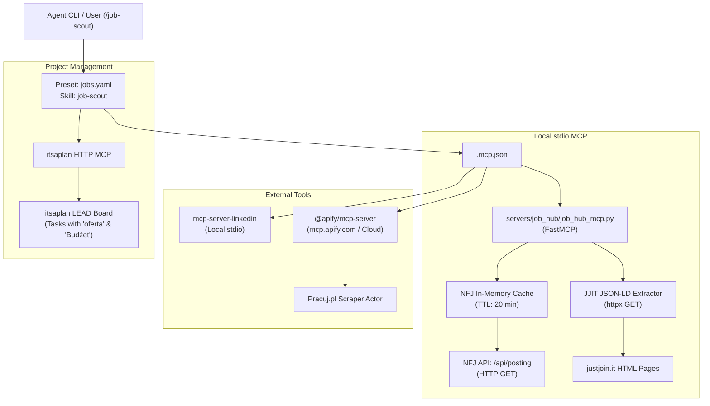

# Design Spec: Multi-Portal Polish Tech Job Hub & Preset for agal

- **Date:** 2026-10-09
- **Status:** Approved
- **Target Preset:** `jobs` (`presets/jobs.yaml`)
- **Target Skill:** `job-scout` (`Skills/job-scout/SKILL.md`)
- **Target MCP Server:** `polish-job-hub` (`servers/job_hub/job_hub_mcp.py`)

---

## 1. Executive Summary & Goals

The goal of this system is to expand `agal`'s job scouting capabilities beyond LinkedIn by integrating Polish IT job boards (**NoFluffJobs**, **JustJoinIT**, and **Pracuj.pl**) into a unified, high-performance, cost-effective workflow.

### Key Tenets
1. **Zero-cost & Low-latency Core**: NoFluffJobs and JustJoinIT run locally via a lightweight FastMCP Python server (`httpx`, no headless browsers, no external proxy fees).
2. **In-Memory Cache for NFJ**: NoFluffJobs' full listings API (`/api/posting`) is cached in memory (TTL 20 min) to provide instant (<10 ms) client-side keyword filtering and avoid hitting NFJ servers repeatedly.
3. **Structured Data Parsing for JJIT**: Instead of deprecated/protected endpoints (`api.justjoin.it` 503), JustJoinIT search is extracted directly from public Next.js SSR pages using official **Schema.org JSON-LD** (`CollectionPage` and `JobPosting` structures).
4. **Isolated Cloud Execution for Pracuj.pl**: Pracuj.pl is queried via the official `@apify/mcp-server` to run in cloud containers, eliminating IP block risks on domestic networks. Operates with *graceful degradation* (skips Pracuj.pl if `APIFY_TOKEN` is unset).
5. **Unified Data Normalization & Deduplication**: Standardized schema across all portals, cross-portal deduplication (URL + Company/Title signature), and direct synchronization to itsaplan `LEAD` project tasks.

---

## 2. Architecture & Components



---

## 3. Local MCP Server Specification (`servers/job_hub/job_hub_mcp.py`)

### 3.1 Dependencies
Managed in `servers/job_hub/pyproject.toml` or running inside the agal venv:
- `mcp[cli]>=1.0.0`
- `httpx>=0.27.0`
- `pydantic>=2.0.0`
- `beautifulsoup4>=4.12.0` (for robust JSON-LD tag extraction)

### 3.2 NoFluffJobs Tool
- **Function**: `search_nofluffjobs(keyword: str, location: str = "", limit: int = 10, work_mode: str = "") -> list[dict]`
- **Data Source**: `GET https://nofluffjobs.com/api/posting`
- **Caching**:
  - Global variable `_nfj_cache = {"timestamp": float, "data": list}`
  - If `now - timestamp > 1200` seconds (20 mins), fetch fresh data and update cache.
- **Filtering Logic**:
  - Keyword match against `item.title`, `item.category`, and `item.tiles.values` (skills).
  - Location/Work-mode match against `item.location.places` and `item.fullyRemote`.
- **Normalization**:
  - Maps `salary.from`, `salary.to`, `salary.type` (b2b/uop), `salary.currency`, and `salary.period` (Hour/Month).

### 3.3 JustJoinIT Tool
- **Function**: `search_justjoin_it(keyword: str, location: str = "", limit: int = 10) -> list[dict]`
- **Data Source**:
  - Listing: `GET https://justjoin.it/job-offers/all-locations/{keyword}`
  - Extract `CollectionPage` JSON-LD from `<script type="application/ld+json">`.
  - For candidate offers (up to `limit * 2`), fetch `https://justjoin.it/job-offer/{slug}`.
  - Extract `JobPosting` JSON-LD.
- **Normalization**:
  - Title: `title`
  - Company: `hiringOrganization.name`
  - Salary: `baseSalary.minValue`, `baseSalary.maxValue`, `baseSalary.currency`, `baseSalary.unitText`
  - Work mode: check `jobLocation` and description for Remote / Hybrid / On-site.

---

## 4. Unified Data Schema (`JobOffer`)

Every tool in `job_hub_mcp.py` returns offers compliant with:

| Field | Type | Description |
|---|---|---|
| `source` | `str` | `"nofluffjobs"`, `"justjoinit"`, `"pracujpl"`, or `"linkedin"` |
| `id` | `str` | Slug or platform ID |
| `title` | `str` | Job title (e.g., "Senior Python Engineer") |
| `company` | `str` | Company name |
| `url` | `str` | Canonical URL to offer |
| `location` | `str` | City or "Remote" |
| `work_mode` | `str` | `"remote"`, `"hybrid"`, or `"office"` |
| `seniority` | `str` | `"Junior"`, `"Mid"`, `"Senior"`, `"Lead"`, or `"N/A"` |
| `contract_types` | `list[str]` | `["b2b"]`, `["uop"]`, or `["b2b", "uop"]` |
| `salary_min` | `float \| None` | Minimum rate/salary |
| `salary_max` | `float \| None` | Maximum rate/salary |
| `salary_currency`| `str \| None` | `"PLN"`, `"EUR"`, `"USD"` |
| `salary_period` | `str \| None` | `"month"` or `"hour"` |
| `salary_display`| `str` | Formatted string, e.g., `"B2B 140–180 zł/h"` |
| `skills` | `list[str]` | Extracted technologies/tags |

---

## 5. Deduplication Strategy

When querying across multiple job boards, identical job postings must not create duplicate tasks in `itsaplan LEAD`.

1. **Exact URL Check**: Query existing tasks in `LEAD` column; if custom field `oferta` equals `offer.url`, drop immediately.
2. **Company + Title Signature**:
   - Normalize string: `slugify(company) + ":" + slugify(simplified_title)`
   - If an existing task in `LEAD` or an offer accepted in the current run shares this signature:
     - Mark as duplicate.
     - Append the secondary URL to the primary task's description (`Znalezione także na: <URL>`).
     - Do NOT create a separate task.

---

## 6. Agal Preset & Skill Integration

### 6.1 Preset Definition (`presets/jobs.yaml`)
```yaml
name: jobs
description: Multi-board job hub (JustJoinIT, NoFluffJobs, LinkedIn, Pracuj.pl) -> taski w itsaplan LEAD
skills:
  - job-scout
mcp:
  - polish-job-hub
  - linkedin
  - itsaplan
  - apify-pracuj-pl
```

### 6.2 Skill Definition (`Skills/job-scout/SKILL.md`)
- **Command:** `/job-scout [limit N] [dry-run] [source <name>]`
- **Criteria Configuration:**
  - Checks `~/.config/job-scout/criteria.md`.
  - Fallback: `~/.config/linkedin-agent/criteria.md` if `job-scout/criteria.md` does not exist.
- **Workflow:**
  1. Load criteria and connect to itsaplan `LEAD`.
  2. Fetch known offer URLs from `LEAD` (`list_issues LEAD`).
  3. Query active tools based on keywords and location in `criteria.md`.
  4. Evaluate rules (TAKE / REJECT, salary thresholds, tech stack).
  5. Deduplicate against known offers.
  6. Create tasks in `LEAD` with appropriate source labels (`justjoinit`, `nofluffjobs`, `linkedin`, `pracujpl`).
  7. Print concise execution summary.

---

## 7. Error Handling & Safety

1. **Graceful Degradation:**
   - If `APIFY_TOKEN` is missing or Apify actor fails: log warning, proceed with local sources.
   - If LinkedIn MCP requires re-authentication: report notice to user, proceed with JJIT and NFJ.
2. **Rate Limiting & Politeness:**
   - JJIT offer detail requests: fetch at most 15 offer pages per run with a polite delay (200ms) to prevent IP throttling.
   - NFJ: served exclusively from local in-memory cache after the initial load.
3. **Data Safety:**
   - Job postings are untrusted data. Descriptions are truncated to 5 lines in itsaplan and never executed as prompts or code instructions.

---

## 8. Verification Strategy

1. **Unit & Integration Tests (`tests/test_job_hub.py`)**:
   - Test NFJ caching and keyword filtering.
   - Test JJIT JSON-LD parsing against mock/live HTML.
   - Test `JobOffer` schema validation and normalization.
2. **MCP stdio Protocol Test**:
   - Run `job_hub_mcp.py` via python and verify JSON-RPC tool listings (`search_nofluffjobs`, `search_justjoin_it`).
3. **Skill Dry-Run**:
   - Run `/job-scout limit 2 dry-run` to verify search, filtering, and reporting without altering `itsaplan LEAD`.
